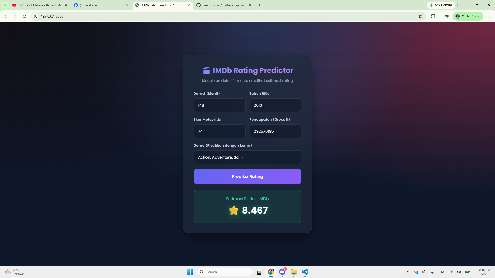

# 🎬 IMDb Rating Prediction (End-to-End Machine Learning)

Proyek Machine Learning ini bertujuan untuk memprediksi rating film IMDb Top 1000 berdasarkan fitur seperti durasi, tahun rilis, skor Metacritic, pendapatan kotor (gross), dan genre. 

Proyek ini telah dikembangkan dari sekadar eksperimen *Jupyter Notebook* menjadi **Aplikasi Web interaktif (End-to-End)** yang siap digunakan.


*(Tampilan antarmuka Web UI modern dengan Dark Mode)*

## 🚀 Fitur Utama
1. **Machine Learning Model:** Menggunakan algoritma `RandomForestRegressor` dengan RMSE terbaik (~0.2314).
2. **REST API:** Dibangun menggunakan Flask untuk menerima *request* JSON dan mengembalikan hasil prediksi.
3. **Web UI Modern:** Antarmuka pengguna interaktif menggunakan HTML, CSS (Glassmorphism/Dark Mode), dan JavaScript Fetch API.

## 📂 Struktur Proyek
```text
├── data/                  # Dataset IMDb (CSV)
├── model/                 # Artefak model (.pkl) dan script training
├── templates/             # Folder untuk file HTML (index.html)
├── app.py                 # File utama Flask API & Web Server
├── requirements.txt       # Daftar library Python yang dibutuhkan
└── README.md              # Dokumentasi proyek